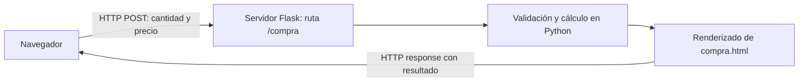

Cuando el empleado, como cliente de la aplicación, escribe en el navegador
la dirección `http://127.0.0.1:5000`, el navegador utiliza la
**dirección IP** `127.0.0.1` para localizar el equipo y el *puerto* `5000`
para establecer la comunicación. El navegador prepara una solicitud
*HTTP*. En el primer acceso a la página, esa solicitud es un `GET` dirigido
a la aplicación.

El *servidor* ejecuta el *backend*, desarrollado en *Python* con
*Flask*, y busca la *ruta* `/compra`. La ruta recibe la petición `GET` y
renderiza el *template* `compra.html`, que forma parte del *frontend*. El
*HTML* define los campos del formulario; el *CSS* y *Bootstrap* dan
estilo y estructura a la página.  solo interviene en componentes
visuales de Bootstrap, como el menú adaptable, y no participa en el cálculo.

El empleado ingresa la cantidad y el precio unitario y envía el formulario.
El navegador crea un *request* con método *POST* que contiene esos valores.
Flask recibe el envío en la misma ruta, valida que ambos datos sean números
válidos y no negativos, y calcula el subtotal. Si el subtotal es mayor que
$1000, aplica un descuento del 10%; de lo contrario, el descuento es cero.

Con esos resultados, Flask renderiza de nuevo el template y prepara una
*response* HTTP con la página actualizada. El navegador interpreta el HTML y
muestra la cantidad, el precio unitario, el subtotal, el descuento y el total
al empleado.

# Diagrama del flujo

El navegador envía los datos mediante `POST`; Flask procesa el cálculo en el
servidor y devuelve la página  con el resultado visible.

